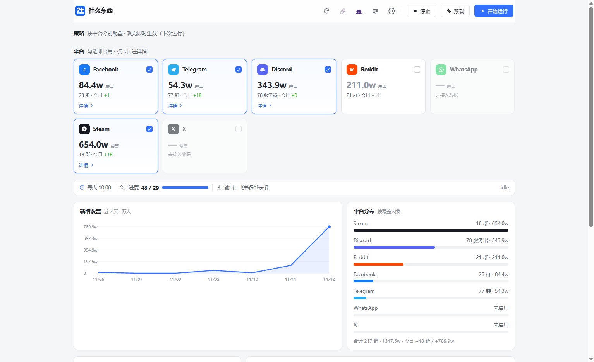
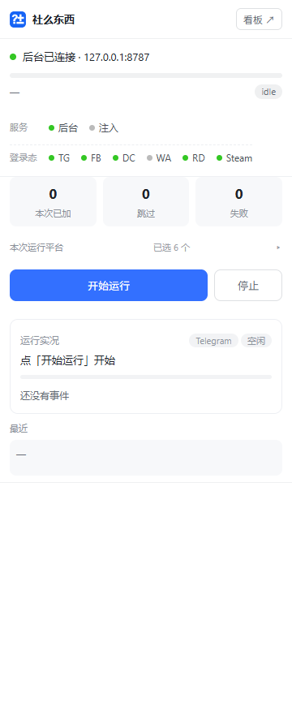
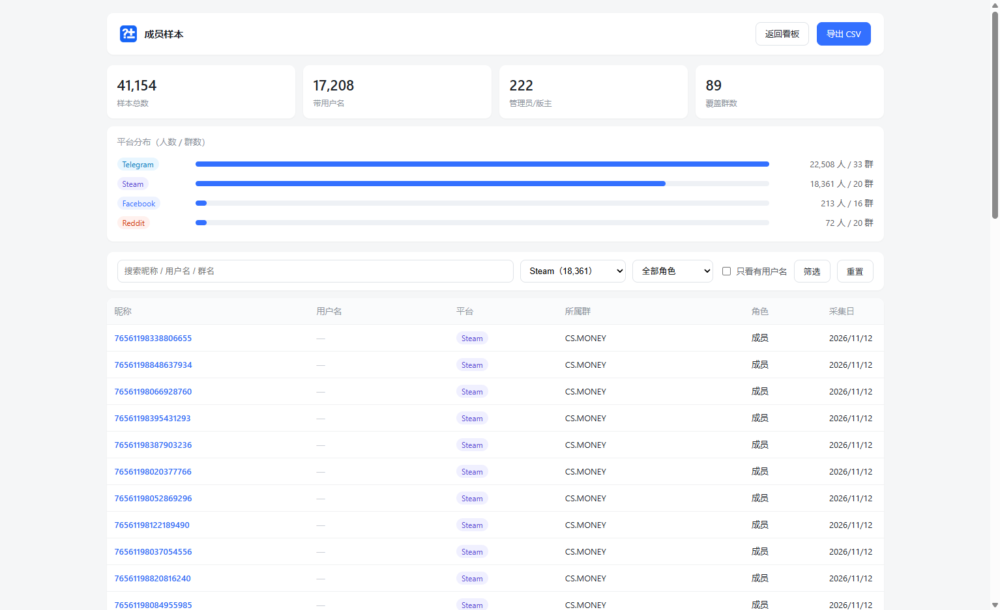
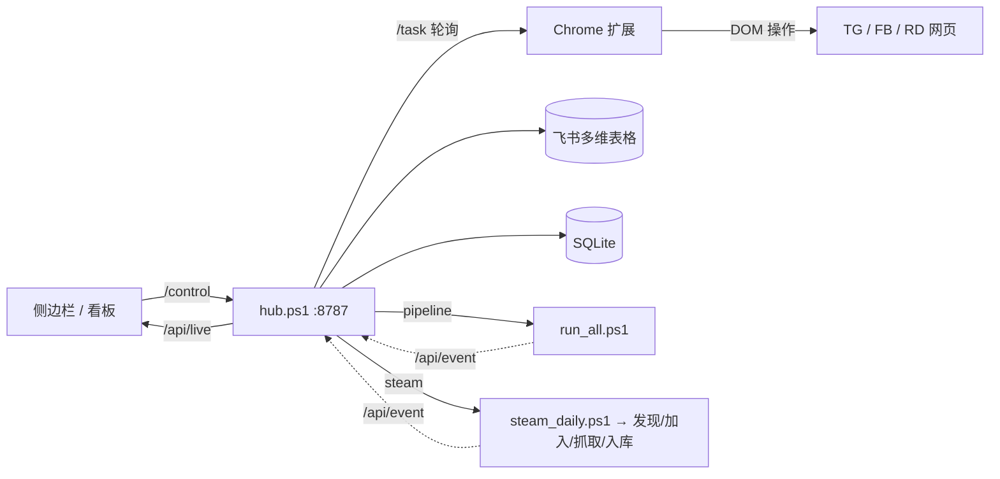

# 社么东西 · GroupOps

**A local, self-hosted tool that grows overseas gaming communities with your own logged-in browser.**
It searches groups across Facebook / Telegram / Reddit / Steam / Discord, joins them at a human pace,
collects member samples, writes everything into a Feishu (Lark) Bitable, and posts a daily report card.

> 用你自己已登录的账号，在海外社媒找群、加群、采人，落库到飞书多维表格并每天出日报。
> 不绕过验证、不申请需要审批的群、不批量加好友 —— 只做「人肉节奏」能做的事，只是把它自动化。



| 侧边栏（扩展） | 成员样本（Steam） |
|---|---|
|  |  |

---

## English summary

- **What it is** — a Chrome MV3 extension + a local PowerShell hub (`127.0.0.1:8787`) that drives your
  own browser session; no headless scraping, no account pooling, no captcha solving.
- **What it does** — discovers groups by keyword, filters by size/activity/language, joins public ones
  with randomized pacing, samples members, and syncs to a Feishu Bitable plus a local SQLite.
- **Platforms** — Facebook, Telegram, Reddit, Steam, Discord (read-only coverage), WhatsApp
  (invite-link only), Instagram (disabled).
- **Hard limits it respects** — groups requiring approval are skipped; Facebook does not expose full
  member lists; Telegram can hide participants; Steam rate-limits by IP (429) and the tool backs off.
- **Runs on** — Windows 10/11, PowerShell 5.1, Google Chrome, Python 3 (optional, for SQLite).

---

## 能力矩阵

| 平台 | 找群 | 加群 | 采成员 | 说明 |
|---|:--:|:--:|:--:|---|
| Facebook | ✅ | ✅ | ⚠️ | 成员页只给「新加入 + 管理员」，全量在数据源层面不存在 |
| Telegram | ✅ | ✅ | ✅ | `channels.getParticipants` 可分页全量；群主可关闭名单 |
| Reddit | ✅ | ✅ | ✅ | 订阅板块 + 抓发帖人；`search.json` 需登录且易 403 |
| Steam | ✅ | ✅ | ✅ | 群成员 XML 页每页 1000 个 SteamID64，唯一可全量枚举 |
| Discord | ✅ | — | — | 只读覆盖率（服务器数 / 总人数），不加 bot、不复用 token |
| WhatsApp | ⚠️ | ✅ | ✅ | 无群搜索，只能邀请链接；命中率低，已判定不作为主渠道 |
| Instagram | — | — | — | 反自动化最严，默认关闭 |

## 架构



三个进程缺一不可：**调试用 Chrome（端口 9222）** + **扩展** + **hub.ps1**。

## 快速开始

```powershell
# 1) 装依赖、建目录、注册计划任务、建库
powershell -ExecutionPolicy Bypass -File .\install.ps1

# 2) 起调试 Chrome（必须在这个窗口里登录各平台）
powershell -File .\start_chrome.ps1

# 3) chrome://extensions -> 开发者模式 -> 加载未打包 -> 选 extension 目录

# 4) 自检（八项，看到「可以开工」即可）
powershell -File .\check.ps1

# 环境不对先跑
powershell -File .\doctor.ps1
```

首次运行会把 `config.example.json` 复制成 `config.json`，需要自己填飞书应用的
`app_id / app_secret / base_app_token / table_id` 与群机器人 `webhook`。

## 数据模型

| 位置 | 内容 |
|---|---|
| 飞书多维表格（21 列） | 群组主表：平台、群ID、群名、链接、成员数、语言、类型、状态、加入日期、潜水到期、日发帖量、采集来源…… |
| `data/users.csv` / `users.jsonl` | 成员样本（平台、群、用户ID、用户名、昵称、角色、采集日…） |
| `data/groupops.db` | SQLite，主键 `(platform, group_id, user_id)`，适合百万级 Steam 成员 |
| `data/steam_meta.json` / `steam_full_state.json` | Steam 页数缓存与断点续跑 |
| `data/skip.json` | 跳过名单（成员不可见 / 需审批） |

成员主页链接**不入库**，由 API 按平台规则实时拼（Steam `profiles/<SteamID64>`、Reddit `/user/<name>`、
Telegram `t.me/<name>`、Facebook `profile.php?id=`、Discord `users/<id>`、WhatsApp `wa.me/<number>`），
所以 CSV 格式保持稳定。

## 换电脑要改什么

只有三处与机器绑定，都在 `config.json -> paths`，留空会自动探测：

| 配置 | 默认行为 |
|---|---|
| `paths.chrome` | 依次探测 Program Files / Program Files (x86) / LocalAppData |
| `paths.chrome_debug_profile` | 留空用 `%LOCALAPPDATA%\GroupOps\chrome-profile` |
| `paths.cdp_port` | 默认 9222 |

新机器需要重新做两件事：在调试 Chrome 里登录各平台；在 `chrome://extensions` 重新加载扩展
（扩展 ID 会变，但代码不依赖 ID，只用 CDP 标签页列表匹配）。

## 不进仓库的东西

`config.json`（含密钥）、`data/`（数据库与样本，数百 MB）、`logs/`、`dist/`。
数据迁移直接拷 `data/` 目录即可。

## 已知限制与合规红线

- **需审批的群一律不加**（`join_request` 直接跳过），不绕过验证码、不模拟人类答题。
- **Facebook 没有全量成员**：成员页只展示「新加入 + 管理员」。
- **Telegram** 部分群开启 `participants_hidden`，只能拿到人数。
- **Steam** 按出口 IP 限流，撞 429 后指数退避（60→360s），并做了页数缓存、自适应间隔、进程互斥。
- **WhatsApp** 无官方群搜索 API，Cloud API 不支持群；已判定不作为主渠道。
- 本项目只处理公开群组的公开信息，请自行遵守各平台条款与当地法律。

## 目录

```
hub.ps1              调度中枢（HttpListener，端口 8787）
run_all.ps1          一键流水线（拓群 → 成员采样 → 人数回填 → 入库 → 日报）
steam_*.ps1          Steam 发现 / 加入 / 抓取 / 入库
tg_*.ps1  fb_*.ps1   Telegram / Facebook 采集与加群
rd_run.ps1           Reddit 订阅与抓人
wa_*.ps1             WhatsApp 链接筛选与成员读取
lib/                 feishu / log / tg / db / paths
extension/           Chrome MV3 扩展（侧边栏 + content bridge）
dashboard.html       Web 看板
users.html           成员样本浏览
docs/                手册、schema、截图
```

## 许可

个人项目，未附许可证；如需复用请先联系作者。
