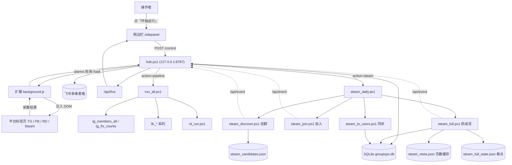
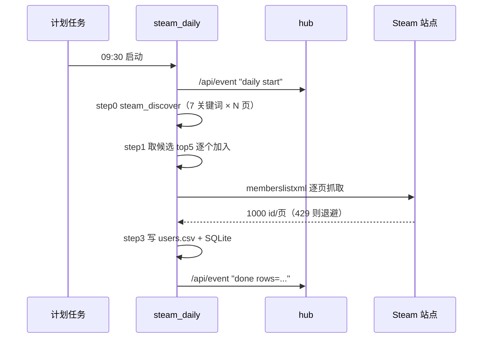

# 社么东西 · 使用手册

> 这份手册只讲「怎么用」。架构和二次开发看 `README.md`，踩坑记录看 `CS2_社群自动化_交接文档.md`。

---

## 0. 四个入口，先认门

| 入口 | 地址 / 打开方式 | 干什么 |
|---|---|---|
| **侧边栏** | 点浏览器工具栏上的扩展图标 | 每天开工按钮，四盏灯看状态 |
| **看板** | http://127.0.0.1:8787/ | 看总量、趋势、待办、最近加入 |
| **成员样本** | http://127.0.0.1:8787/users | 2 万多条成员，筛选/导出 |
| **命令行** | `run.ps1` / `check.ps1` | 无人值守跑、自检 |

后台是那个 `hub`（本地 8787 端口）。**没有它，侧边栏和看板都是空的。**

---

## 1. 第一次用（只做一次，约 10 分钟）

### ① 打开专用浏览器
```powershell
D:\DeepSeek\运营\start_chrome.ps1
```
这个 Chrome 用了独立配置（`D:\ChromeFeishu\profile`），并且带防冻结参数 —— 别用日常那个 Chrome，否则后台标签会被冻结，报 `page timeout`。

### ② 在这个窗口里登录
- **Telegram**：打开 `web.telegram.org/k/` → 手机扫二维码
- **Facebook**：打开 `facebook.com` → 账号密码登录

登录态存在这个独立配置里，**下次不用再登**（除非平台踢会话）。

### ③ 确认后台在跑
```powershell
Start-ScheduledTask -TaskName "DSH_SocialOps_Hub"
```
这个计划任务是**开机自启 + 崩溃自动重启**的，正常情况下不用管。

### ④ 自检
```powershell
D:\DeepSeek\运营\check.ps1
```
七项全绿会打印「可以开工」。红了看第五节。

### ⑤ 看四盏灯
点扩展图标 → 侧边栏顶部：

| 灯 | 绿 = | 灰/红 = |
|---|---|---|
| 后台 | hub 在跑 | 复制下面那行命令去启动 |
| TG 会话 | 真的能调 API | 会话死了，要重扫 |
| FB 登录 | 有 c_user | 没登录 |
| 注入权限 | 扩展能操作页面 | 去 chrome://extensions 打开站点权限 |

---

## 2. 每天怎么跑

### 方式 A：点按钮（推荐）
1. 点扩展图标 → 侧边栏
2. 勾选本次要跑的平台（FB / TG）
3. 点 **开始运行**

就这样。跑的过程中侧边栏会显示「本次已加 / 跳过 / 失败」，跑完自动写飞书、发日报卡片。

### 方式 B：命令行（想无人值守）
```powershell
D:\DeepSeek\运营\run.ps1 -Platform Telegram
D:\DeepSeek\运营\run.ps1 -Platform Facebook -DryRun   # 只看会加哪些，不真加
```

### 方式 C：定时
已经装了 `DSH_SocialOps_Daily`，每天 **10:00** 自动跑，配额读配置。不想定时就在策略页把「每日定时」关掉，任务会自动删除。

---

## 3. 看板怎么读

- **5 张平台卡**：覆盖人数 + 群数 + 今日新增。勾选 = 启用，取消 = 本次不跑
- **今日进度 24 / 25**：分子是今天加的，分母是所有启用平台的配额之和
- **近 7 天新增覆盖**：蓝线是人数，虚线是群数
- **待办**：需要你决定的（需验证的群、失效的群）
- **最近加入**：最新 5 条

点任意平台卡 → **平台工作台**（三数字卡 + 任务卡）。目前只开放「拓群」，其余标注「开发中」。

---

## 4. 调策略（不用改文件了）

顶部 **策略图标** → 选平台 tab → 四块：

| 卡片 | 你现在能改什么 |
|---|---|
| ① 群组要求 | 最小人数、是否必须公开群、近 N 天有发言、允许语言、排除词正则、必含词 |
| ② 搜索策略 | 三个来源的开关与上限（P1 外部搜索 / P2 种子清单 / P3 站内搜索）+ **站内关键词增删** + **站外关键词增删** |
| ③ 执行节奏 | 加群间隔（45–180 秒）、搜索间隔、连续失败熔断、FLOOD_WAIT 额外等待 |
| ④ 告警 | 开关、机器人 webhook、探针间隔、失败阈值 |

改完点 **保存策略** → 写进 `config.json` → **下一次运行生效**。

**人数不够时会自动补位**：把门槛降到 1/3（不低于 200）再扫一轮。

---

## 5. 红灯和常见故障对照表

| 现象 | 含义 | 怎么办 |
|---|---|---|
| 侧边栏「后台未启动」 | hub 没跑 | 点「复制启动命令」粘贴到 PowerShell |
| TG 灯灰 + 日志 `api-timeout` | Telegram 会话死了 | 在那个窗口刷新 `web.telegram.org` 重扫码；连续 3 次自愈失败会发飞书告警 |
| TG 灯灰 + `no tab` | 标签页被关了 | 等一下，扩展会自动重开 |
| FB 灯灰 | 没登录 / 标签页没了 | 重开 facebook.com 登录（扩展会先自动重开） |
| 权限灯灰 | 扩展站点权限没给 | chrome://extensions → 详情 → 站点访问权限打开 |
| 日志 `page timeout` | 后台标签被系统冻结 | 用 `start_chrome.ps1` 重启专用 Chrome |
| `FLOOD_WAIT_xxx` | 平台限流 | 等够那个秒数，策略里把间隔调大 |
| 看板打不开 `ERR_CONNECTION_REFUSED` | hub 挂了 | `Start-ScheduledTask -TaskName "DSH_SocialOps_Hub"` |
| 某群采样总是 0 | 群主关了成员可见 | 已自动进跳过名单 `data/skip.json`，不再白跑 |

**遇到验证码 / 人机校验：立刻停，不要硬闯。** 这是账号级风险，不是脚本能解决的。

---

## 6. 成员样本怎么用

看板页头的人像图标 → `/users`：

- 顶部四个数：样本总数 / 带用户名 / 管理员版主 / 覆盖群数
- 筛选：搜索框（昵称·用户名·群名）、平台、角色、只看有用户名
- 分页 50/条，右上「导出 CSV」下全量

**自己采样一条群：**
```powershell
D:\DeepSeek\运营\tg_members.ps1 -Username traders_cs2 -Max 3000
D:\DeepSeek\运营\tg_members_all.ps1 -MaxPerGroup 3000   # 所有 TG 群
```

**关于「全量」，两个平台的差别要说清：**

| | Telegram | Facebook |
|---|---|---|
| 成员列表 | 能翻页（`channels.getParticipants`），但**群主可以隐藏**，隐藏了就一个都拿不到 | **页面根本不列全量**，只给「新加入成员 + 管理员/版主」 |
| 能拿到的字段 | 用户 ID、@用户名、昵称、是否管理员 | 昵称、主页 ID |
| 所以 | 能翻多少翻多少（每群上限 3000/天） | 只能做「新加入 + 管理员」样本 |

---

## 7. 数据都在哪

```
D:\DeepSeek\运营\
├─ config.json          ← 策略真身（策略页改的就是它）
├─ tasks.json           ← 每个平台的任务开关与参数
├─ data\
│  ├─ users.csv/.jsonl  ← 成员样本（22,721 条）
│  ├─ skip.json         ← 跳过名单（成员隐藏的群）
│  ├─ cursor_tg.json    ← 采样断点，接着上次继续
│  ├─ batch_report.json ← 批量采样结果
│  └─ groups.jsonl/.csv ← 加群本地留档
└─ logs\
   ├─ hub.log           ← 后台日志
   ├─ tg_members.log    ← 采样日志
   └─ alerts.log        ← 告警记录
```

飞书那张「私域社群表」是主库（21 列），本地只是副本和样本。

---

## 8. 三条纪律

1. **配额别超**：FB 5 个/天、TG 20 个/天。这是账号安全线，不是效率线
2. **验证码即停**：出现人机校验当天就收工，熔断已经写进代码
3. **同一账号别开两个浏览器**：调试 Chrome 和日常 Chrome 同时登录同一个号，会互相踢会话

---

## 9. 五个高频问题

**Q：跑完没写进飞书？**
A：看 `logs\hub.log` 有没有 `feishu` 报错；写入失败会重试，仍失败会进 `data\groups.jsonl` 兜底，可以事后补。

**Q：加群加得太慢？**
A：慢是设计——间隔 45–180 秒是防封号的。想快就减少单次配额，别缩间隔。

**Q：能不能一批跑 100 个群？**
A：不能。TG 连续加群会 `FLOOD_WAIT`，FB 会直接 checkpoint。

**Q：改了策略没生效？**
A：策略页改动是**下次运行**生效；正在跑的这批还用旧参数。看板上点「重新加载」刷新显示。

**Q：怎么彻底停掉？**
A：侧边栏「停止」；彻底停就 `Stop-ScheduledTask -TaskName "DSH_SocialOps_Hub"`，并删掉每天 10:00 的定时。

---

祝顺利。有红灯先看第五节的表，八成能在里面找到。
---

## 九、手动跑一轮（四个平台分开跑，互不影响）

前提：Chrome 用 `start_chrome.ps1` 起（带 9222 调试口），hub 在跑（`run_hub.ps1` 或计划任务 DSH_SocialOps_Hub）。侧边栏打开后先看四盏灯：**后台 / TG 会话 / FB 登录 / 注入权限** 全绿再跑。

### 9.1 一条命令跑完整轮（TG + FB 拓群，最省事）

```powershell
powershell -NoProfile -ExecutionPolicy Bypass -File D:\DeepSeek\运营\run.ps1
```

它按顺序做：探活 → 发现（seeds → 外部搜索 → 关键词）→ 过滤 → seed → 等扩展加群 → 汇总落飞书。

- 只跑指定平台：`-Platforms Telegram` 或 `-Platforms Facebook`
- 只看候选不加群：`-DryRun`
- 退出码：`3` = 后台没起；`4` = TG 会话掉了（去刷新 web.telegram.org 重新扫码）

### 9.2 也可以点侧边栏「开始运行」

和在命令行跑 `run.ps1` 等价，多平台勾选后点最下面那颗蓝色按钮。想中途停就点「停止」。

### 9.3 Steam（加群 + 采成员）

```powershell
# 加群（队列在 data\steam_queue.txt，一行一个群标识符，如 cs2trade / 123456789）
powershell -NoProfile -ExecutionPolicy Bypass -File D:\DeepSeek\运营\steam_join.ps1 -Queue D:\DeepSeek\运营\data\steam_queue.txt

# 采成员（公开群，每页 1000 人，能翻到底，量大注意别一次全跑）
powershell -NoProfile -ExecutionPolicy Bypass -File D:\DeepSeek\运营\steam_members.ps1 -Group cs2trade -MaxPages 50
```

Steam 判定：群页出现 `Leave Group` 且没有 `Join Group` = 已在群里。加完可以在 `/my/groups/` 复核。

### 9.4 Reddit（订阅板块 + 抓发帖人）

```powershell
powershell -NoProfile -ExecutionPolicy Bypass -File D:\DeepSeek\运营\rd_run.ps1
```

需要先登录 reddit.com（账号 xzkiller1107）。它读 `/api/me.json` 拿 modhash，再订阅 `config.json` 里 `strategy.Reddit.keywords` 命中的板块。

### 9.5 WhatsApp（当前**暂停拓群**）

结论已写进复盘：没有目录、TG 两万条消息零命中、群主多设审批。现在只保留采集能力，遇到别人给的邀请码可以手动加：

```powershell
powershell -NoProfile -ExecutionPolicy Bypass -File D:\DeepSeek\运营\wa_members.ps1 -AcceptCode <邀请码> -WaitSec 25
```

**退群要手动**（WhatsApp Web 的退群按钮在群信息面板滚动到底部，脚本点不到）：
1. 左侧点开该群
2. 点顶部群名 → 打开群信息面板
3. 面板**滚到最下面** → 点「退出群组 / Exit group」→ 确认

### 9.6 跑完去哪看

- 看板：浏览器打开 `http://127.0.0.1:8787/`（或侧边栏右上「看板 ↗」）
- 成员样本：`http://127.0.0.1:8787/users`
- 运行实况：侧边栏中部，2 秒刷新，最近 40 条
- 原始数据：`data\` 下 `users.csv`、`wa_users.csv`、`steam_users.csv`、`wa_screen.csv`
- 日志：`logs\hub.log`、`logs\wa_screen.log`、`logs\steam.log`

### 9.7 重要：跑 Facebook 前必须让 hub 绑定 Facebook

`run.ps1` 的发现阶段只服务 Telegram（读 `seeds.txt` + 外部搜索），**不会走 FB 的「站内群搜索」**。FB 必须让 hub 以 Facebook 身份启动，由扩展自己去搜：

```powershell
# 1) 杀掉当前 hub
Get-CimInstance Win32_Process -Filter "Name='powershell.exe'" | Where-Object { $_.CommandLine -match "hub\.ps1" } | ForEach-Object { Stop-Process -Id $_.ProcessId -Force }

# 2) 以 Facebook 身份重启
Start-Process powershell -ArgumentList "-NoProfile","-ExecutionPolicy","Bypass","-File","D:\DeepSeek\运营\hub.ps1","-Platform","Facebook" -WindowStyle Hidden

# 3) 触发一轮（等价于点侧边栏「开始运行」）
Invoke-RestMethod "http://127.0.0.1:8787/control" -Method Post -Body '{"action":"start"}' -ContentType "application/json"

# 4) 看进度
Invoke-RestMethod "http://127.0.0.1:8787/state"
```

跑完 FB 要跑 TG 时，再把 hub 用 `-Platform Telegram` 重启一次。**hub 一次只服务一个平台**，这是当前架构的限制。

### 9.8 一键跑完整流程（推荐，不用逐个点脚本）

看板（http://127.0.0.1:8787/）右上角 **「开始运行」** 现在等于跑完整流水线，顺序是：

1. `check.ps1` 自检（八项，有红灯直接中止，不会带着问题跑）
2. 逐平台拓群：`run_all.ps1` 依次让 hub 绑定 `Telegram` / `Facebook` / `Reddit` 跑一轮
3. `tg_members_all.ps1` 采 TG 成员样本
4. `tg_fix_counts.ps1 -IncludeHidden` 回填真实人数（含「名单不可见但人数可见」的群）
5. `steam_sample_all.ps1` 对飞书里所有 Steam 群各抽 1 页
6. `steam_to_users.ps1` 把 Steam 成员并进「成员样本」
7. 需要日报时加 `-Report`

命令行等价写法：

```powershell
powershell -NoProfile -ExecutionPolicy Bypass -File "D:\DeepSeek\运营\run_all.ps1"

# 只跑 TG、跳过成员采样与 Steam、最后发日报
powershell -NoProfile -ExecutionPolicy Bypass -File "D:\DeepSeek\运营\run_all.ps1" -Platforms "Telegram" -SkipMembers -SkipSteam -Report
```

- 退出码：`3` = 自检没过；`4` = 有平台跑失败（其余平台仍会继续）
- 日志：`logs\run_all.log`（每个阶段一行，带时间戳）

### 9.9 修复类脚本（发现问题时手动跑）

| 场景 | 命令 |
|---|---|
| 飞书里有群的「成员数」是 0，或显示「名单不可见」 | `powershell -File "D:\DeepSeek\运营\tg_fix_counts.ps1" -IncludeHidden` |
| Steam 群成员要补录进「成员样本」 | `powershell -File "D:\DeepSeek\运营\steam_to_users.ps1"` |
| 想重抽所有 Steam 群成员 | `powershell -File "D:\DeepSeek\运营\steam_sample_all.ps1" -MaxPages 1` |

`tg_fix_counts.ps1` 读的是飞书全表，按 `群组唯一键` 回填，**幂等**，重复跑不会产生重复行。

### 9.10 本地数据库（SQLite，推荐用于海量成员）

飞书多维表格单表上限约 2 万行，Steam 全量成员（约 650 万）装不下，所以成员明细另存本地 SQLite。

**在哪**：`data\groupops.db`（一个文件，随项目走，可直接拷走/备份）

**表结构**（`users`）：

| 字段 | 含义 |
|---|---|
| platform | Telegram / Steam / Facebook / Reddit |
| group_id / group_name | 群 ID 与群名 |
| user_id | 平台内的用户 ID（Telegram 数字 ID、SteamID64） |
| username / nickname / role / lang | 用户名、昵称、角色、语言 |
| last_active / collected_at / source | 最近活跃、采集日、来源 |
| status | 有效 / 已退出 等 |

主键是 `(platform, group_id, user_id)` —— 同一个群里重复采到同一人会自动更新，不会产生重复行。

**三种操作方式**

1. 看板最下面「本地数据库」卡片：显示行数 / 群数 / 平台数 / 文件大小，两个按钮「初始化数据库」「导入本地 users.csv」
2. 命令行：
   ```powershell
   powershell -File "D:\DeepSeek\运营\db_init.ps1"                 # 建库建表（可重复跑）
   powershell -File "D:\DeepSeek\运营\db_import.ps1"               # 导入 data\users.csv
   powershell -File "D:\DeepSeek\运营\db_stats.ps1"                # 看概况
   ```
3. 一键流程：`run_all.ps1` 在 Steam 导入后会**自动**同步一次数据库

**新机器上从零搭**

```powershell
# 1) 需要 python（本机已有 DSH 自带 python，脚本会自动找）
#    如果想用别的解释器，在 config.json 里写 "db": { "python": "C:\\Python311\\python.exe" }

# 2) 建库
powershell -File "D:\DeepSeek\运营\db_init.ps1"

# 3) 导入现有 CSV（users.csv / steam_users.csv 都能吃）
powershell -File "D:\DeepSeek\运营\db_import.ps1" -Csv "D:\DeepSeek\运营\data\users.csv"

# 4) 校验
powershell -File "D:\DeepSeek\运营\db_stats.ps1"
```

**备份**：直接复制 `data\groupops.db`（导入前先停 hub，或复制 `groupops.db`+`groupops.db-wal`）。数据大了之后可以跑 `python db_tool.py vacuum` 压缩。

## 十一、Steam 每日流程（插件内）

一键入口：看板「开始运行」或 `POST /control {"action":"steam"}`，实际跑 `steam_daily.ps1`。

| 步骤 | 脚本 | 说明 |
|---|---|---|
| step0 | `steam_discover.ps1` | 从 `steamcommunity.com/search/groups/?text=<kw>` 挖群，7 个关键词 ×N 页，写 `data\steam_candidates.json` |
| step1 | `steam_join.ps1 -Group <slug>` | 取候选 top5 加入（每个群都要过一次限流） |
| step2 | `steam_full.ps1` | 逐页抓 `memberslistxml` 写 SQLite，默认 40 页/群、12 秒/页 |
| step3 | `steam_to_users.ps1` + 导入本地库 | 同步 `users.csv` 与 `groupops.db` |

- 计划任务 `DSH_SocialOps_Steam`：每天 09:30 自动跑一轮。
- 限流：Steam XML 端点会 429，脚本自动退避 60/120/180/240/300 秒（最多 6 次），不会中断。**发现与抓取共用同一额度**，不要同时跑。
- 只跑抓取：`steam_full.ps1 -MaxPages 40 -DelayMs 12000`；只跑发现：`steam_discover.ps1 -MaxPages 3`。
- 候选池：`data\steam_candidates.json`（按 members 降序），加过的群会在下一次发现时被排除。

## 十二、架构与数据流（2026-11-12 版）



### 每日 Steam 流程（计划任务 09:30）



### 关键约定

- **额度**：Steam 按「出口 IP + 时间窗口」限流，插件、脚本、手动都记同一个账。
- **退避**：429 → 60/120/180/240/300/360 秒重试，6 次后跳过该页。
- **自适应**：撞 429 间隔翻倍（封顶 120s），连续成功 10 页减半。
- **缓存**：`steam_meta.json` 记总页数/人数，已抓满的群 0 请求跳过。
- **互斥**：`data/steam.lock` 保证同一时刻只有一个 Steam 任务在跑。
